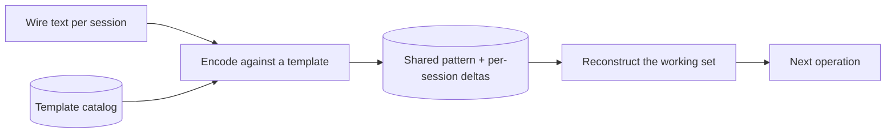
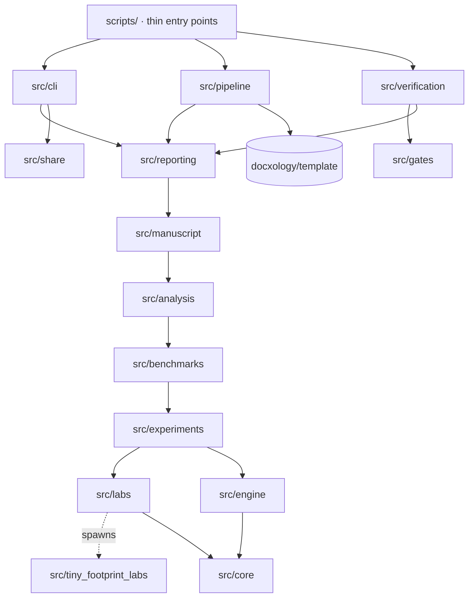
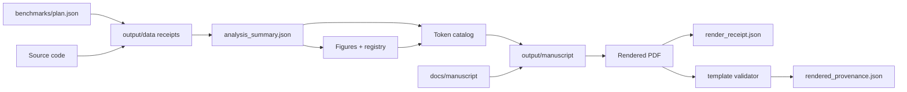

# Architecture overview

## The idea under test

A session's context often repeats what other sessions hold. The engine stores a shared pattern once and represents each session as a reference plus what differs. A *rhyme* widens "shared" from identical text to the same organization: the same fields holding the same kinds of values, even when the words differ.

## How the repository is layered

Dependencies point down, and [`src/gates/layers.mjs`](../../src/gates/layers.mjs) enforces it: a module imports only from its own folder or a lower layer. The diagram shows the main edges, and any lower layer may be imported directly.

| Layer | Responsibility |
|---|---|
| [`src/core`](../../src/core/README.md) | Bytes, statistics, seeded randomness, hashing, formats, paths |
| [`src/engine`](../../src/engine/README.md) | Tiny Gateway: templates, vectors, broadcast, the gateway |
| [`src/sdk`](../../src/sdk/README.md) | The public facade |
| [`src/experiments`](../../src/experiments/README.md) | The registered suite, one module per experiment |
| [`src/labs`](../../src/labs/README.md) | Adapters that run the Python labs and report what actually ran |
| [`src/tiny_footprint_labs`](../../src/tiny_footprint_labs/README.md) | Python labs and figures |
| [`src/benchmarks`](../../src/benchmarks/README.md) | The deterministic and measured tiers |
| [`src/analysis`](../../src/analysis/README.md) | Reduces receipts to one summary, and evaluates the claim ledger |
| [`src/manuscript`](../../src/manuscript/README.md) | Token catalog, hydration, the hard-coded-value gate |
| [`src/pipeline`](../../src/pipeline/README.md) | The stage graph and the binding to the template |
| [`src/verification`](../../src/verification/README.md) | Re-derives each artifact and compares it with what is on disk |
| [`src/gates`](../../src/gates/README.md) | Repository structure rules |
| [`src/reporting`](../../src/reporting/README.md), [`src/share`](../../src/share/README.md), [`src/cli`](../../src/cli/README.md) | The customer-facing kit |

## How a number reaches the page

There is one path, and each step can be re-derived from the one before.

[`scripts/verify_project.mjs`](../../scripts/README.md) walks this chain. It re-runs the deterministic tier, re-reduces the receipts, re-hydrates the manuscript, and compares each result with the file on disk.

## Decisions worth knowing

**Two languages, one rule.** The kit installs with Node and no dependencies, so everything a customer runs stays there. Python appears only where the work requires it: PyTorch for real models, ctypes for the NVIDIA driver, Matplotlib for figures. Logic in either language lives under `src/`, with a mirrored test.

**Old paths keep working.** Code once lived under `research/synthobs-tiny-gateway-rhyming-templates/src/`. Those paths are now re-exports of the canonical modules, so existing imports and `npm run research` still work, and a gate stops logic growing back there. See the [source map](source-map.md).

**`not_run` is an outcome.** A lab that cannot run on a host has produced no evidence either way. The verdict is `all_pass`, `incomplete` or `fail`, so a host without a GPU reads as incomplete. See [`src/labs`](../../src/labs/README.md) for the defect this replaced.

**Historical receipts are read-only.** The receipts in `research/.../data/` describe a GTX 860M laptop. Analysis binds them by hash and reports them as history, and no pipeline stage writes there.

**The template owns rendering.** This repository produces hydrated Markdown and figures. [docxology/template](https://github.com/docxology/template) turns them into a PDF. See [running the benchmarks](../benchmarks/running.md#rendering-the-manuscript).

## The website

The FractiSI marketing site is static HTML at the repository root: `index.html`, [`company/`](../../company/README.md), [`library/`](../../library/README.md), [`open/`](../../open/README.md), [`product/`](../../product/README.md), [`recruit/`](../../recruit/README.md) and `research/index.html`, with styles in [`css/`](../../css/README.md) and images in [`media/`](../../media/README.md). `vercel.json` configures its deployment to https://fractisi.vercel.app.

The pipeline reads none of it except one image in `media/`, and no test checks the site's numbers. The site does tell readers to run five commands, `doctor`, `install`, `demo`, `benchmark` and `report`, through `node scripts/tiny.mjs`, so those commands are a compatibility surface. `tests/integration/compatibility-paths.test.mjs` reads them from the pages and checks that the CLI still has them.
