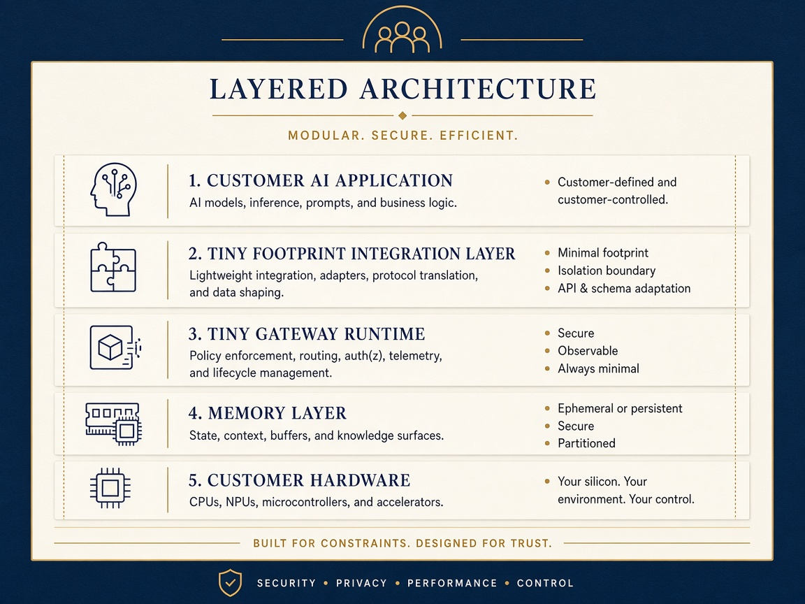

# Introduction {#sec:introduction}

Serving many sessions from one language model repeats a large amount of state. System prompts, tool schemas and policy text recur across requests, and the key-value (KV) cache that holds a model's attention state grows with every token. @kwon2023efficient identify KV-cache memory as a limit on batch size and report that fragmentation and redundant duplication waste it. Prefix sharing is now a mainstream response: SGLang reuses KV cache through RadixAttention [@zheng2023sglang], and Prompt Cache reuses attention states across prompts through an explicit schema of reusable segments [@gim2023promptcache].

The Tiny Footprint Workstation is a commercial developer kit from FractiAI that addresses the same pressure with a broader idea. Its engine, Tiny Gateway, organizes state around *Rhyming Templates*: a rhyme matches organization, meaning the same fields holding the same kinds of values, even when the words differ. A template is stored once and each session keeps only what differs. The vendor's positioning appears in [@fig:vendor_architecture]. The kit's headline is less memory, lower latency and more AI performance.

{#fig:vendor_architecture width=62%}

Claims of this kind are easy to state on a denominator that flatters them. A size reduction may be measured on serialized text and not on memory, against a baseline nobody would deploy, or on one machine and then generalized to another. An earlier audit of this repository narrowed its public language to what the labs measured. This study takes the next step and measures the claims again, on one pipeline that a reader can rerun.

## A defect this work corrected {#sec:intro_defect}

Before this work, the kit's benchmark command read lab receipts from disk whether or not the lab had just run. On a machine with no NVIDIA GPU the lab could not start, the stored receipt was read anyway, and the suite reported every experiment as passing. The customer report then named the {{HIST_DEVICE}} as the device under test, on hardware that was not that device. Such a run also overwrote tracked receipts. The README promised results from the reader's own machine, so this was a defect and not a matter of interpretation. Labs now report only what ran in the current invocation, with `not_run` as an outcome distinct from pass and fail. On the host used here the corrected suite reports a verdict of `{{SUITE_VERDICT}}`: {{SUITE_PASS}} experiments pass, {{SUITE_FAIL}} fail and {{SUITE_NOT_RUN}} did not run, and it withholds the engine pin. FractiAI's latest release again reuses a stored GPU receipt by default, now labelled as cached, and still counts it as a pass, so this study's code keeps the corrected behaviour.

## Contributions {#sec:contributions}

This study makes four contributions.

1. It separates evidence into tiers that cannot be confused: byte accounting identical on any machine, measurements bound to one named host, simulations, and historical receipts from other hardware.
2. It reproduces the published byte results exactly, then shows how far they depend on workload selection, weighting and baseline.
3. It measures what the byte results stand in for: the live V8 heap, resident set size, materialization latency, and KV residency on real models with an output-equivalence check.
4. It evaluates each public claim against that evidence in a computed ledger, [@sec:claim_ledger], whose statuses change if the data change.

Every study value in this document, including those in tables, captions and alternative text, is injected from a receipt at build time. A gate fails the build if a study value is typed into the authored source ([@sec:reproducibility]).
