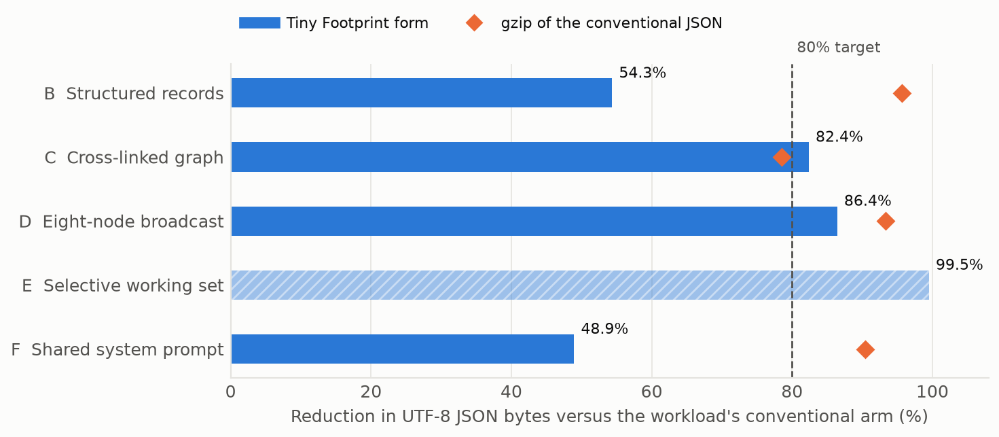
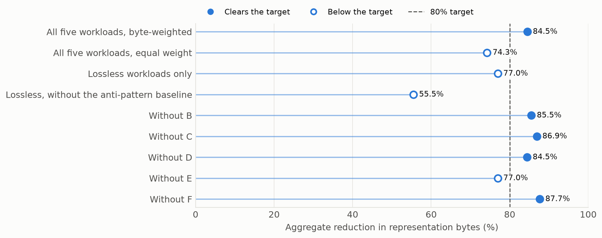
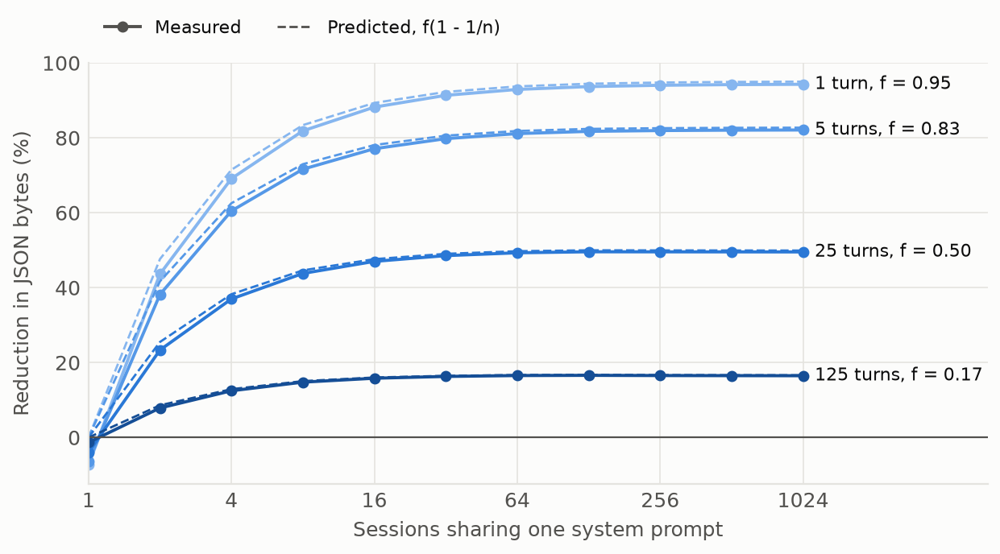
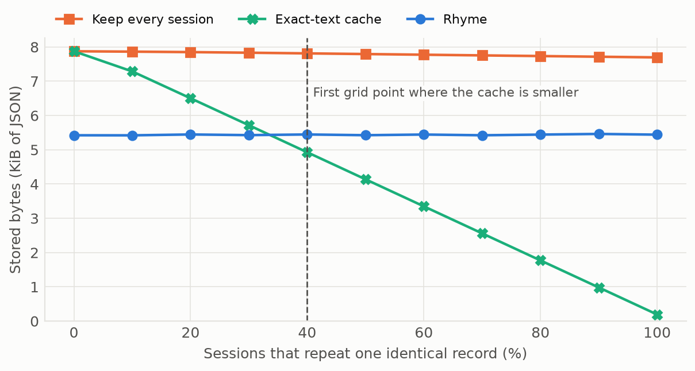
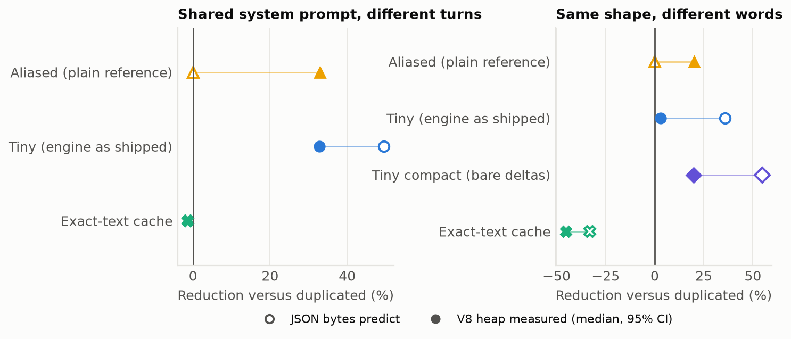
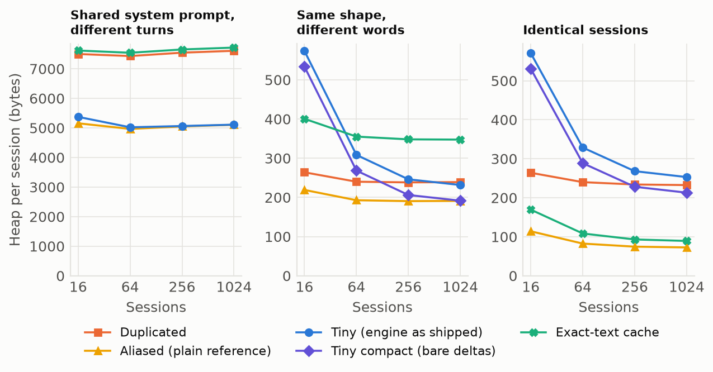
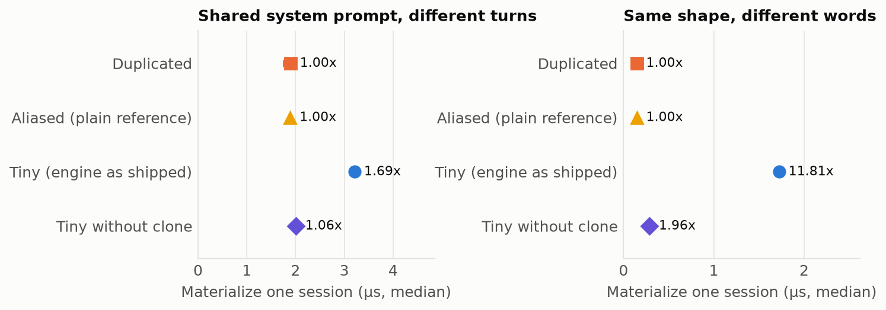
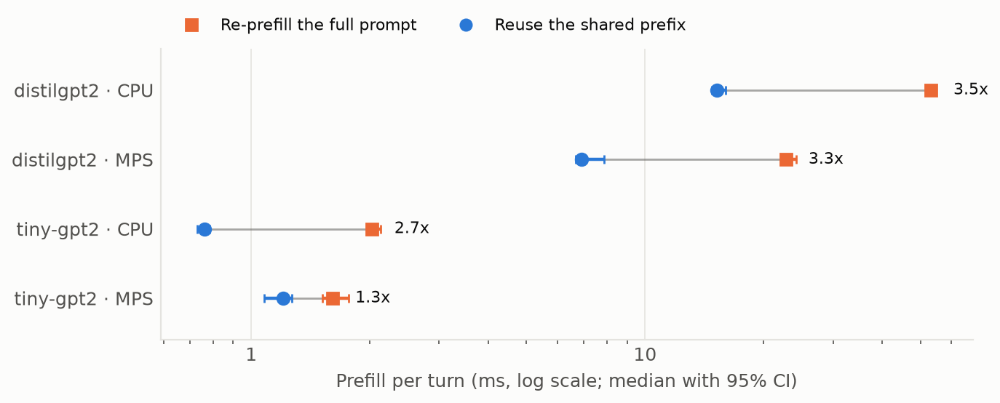
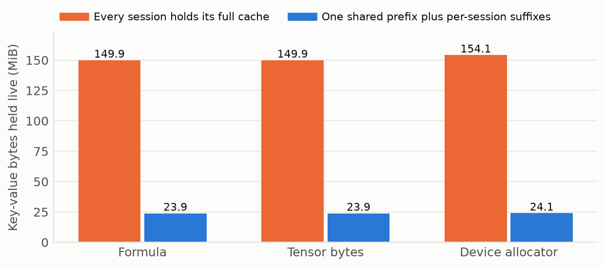
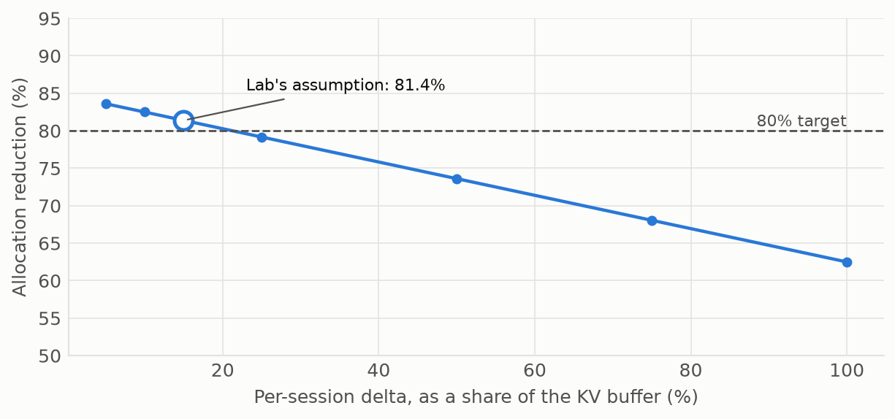

# Results {#sec:results}

## The published byte results reproduce exactly {#sec:res_bytes}

*Tier: deterministic.* All workload reductions match the historical receipt to every digit, and the aggregate reproduces at {{AGG_PUBLISHED}}. The values are in [@tbl:workloads] and [@fig:workload_reductions]. Full round trips hold for every record in the lossless workloads. Workload E is different in kind: its working set contains {{E_WORKING}} of {{E_TOTAL}} vectors, so its {{E_REDUCTION}} reduction is the size of one request's closure compared with the whole lattice, and it cannot reconstruct the rest.

{{TABLE_WORKLOADS}}

: Representation bytes per workload, with gzip of the conventional JSON as a yardstick and full round-trip results. {#tbl:workloads}

{#fig:workload_reductions width=92%}

gzip exceeds the template reduction on {{GZIP_BEATS_COUNT}} of {{GZIP_TOTAL}} lossless workloads. The redundancy is real, and general-purpose compression also finds it, at the cost of not being usable in place.

## The aggregate depends on selection and weighting {#sec:res_sensitivity}

*Tier: deterministic.* Workloads C and E together supply {{BYTE_SHARE_CE}} of the baseline bytes, so by [@eq:aggregate] they dominate the aggregate. The alternatives in [@fig:aggregate_sensitivity] recompute it. Equal weighting gives {{AGG_UNWEIGHTED}}. Removing E, which is not lossless, gives {{AGG_LOSSLESS}}. Removing C's anti-pattern baseline as well gives {{AGG_NON_STRAWMAN}}. The {{TARGET}} gate is cleared under the published weighting and under {{LOO_CLEARS}} of {{LOO_TOTAL}} leave-one-out variants; the variant below it leaves out {{LOO_FAILING}}.

{#fig:aggregate_sensitivity width=92%}

Workload C's baseline deserves separate attention. Moving from embedded node copies to edges that refer to nodes by id, with no template engine, saves {{C_TO_NORMALIZED}}. Against that normalized graph, the Tiny form is {{C_TINY_OVER_NORMALIZED}} larger, because each edge carries a template reference and an index. In this workload the saving comes from normalization.

## Saving is bounded by the shared fraction {#sec:res_scaling}

*Tier: deterministic.* The test of [@prop:saturation] on the real encoding is in [@fig:session_scaling]. Measured reductions track the closed form within {{SCALING_MAX_ERROR}} points at every grid position, the gap coming from a small fixed overhead visible at low session counts. The ceiling is the practical result: at {{SCALING_LONG_TURNS}} turns per session the reduction saturates near {{SCALING_LONG_REDUCTION}} regardless of how many sessions share the prompt, against {{SCALING_SHORT_REDUCTION}} at {{SCALING_SHORT_TURNS}} turn.

{#fig:session_scaling width=92%}

## The exact cache overtakes the rhyme as duplicates grow {#sec:res_crossover}

*Tier: deterministic.* With {{CROSSOVER_SESSIONS}} same-shaped sessions and different words, the rhyme stores {{RHYME_DIFFERING_BYTES}} bytes against {{RHYME_DIFFERING_CACHE}} for an exact-text cache, {{RHYME_VS_CACHE}} less. When all sessions repeat the same words, the cache stores {{RHYME_IDENTICAL_CACHE}} bytes and the rhyme {{RHYME_IDENTICAL_BYTES}}. The sweep in [@fig:rhyme_crossover] fills in between: the cache is already smaller at {{CROSSOVER_AT}} duplicates on the tested grid. Reconstruction matched at every point.

{#fig:rhyme_crossover width=92%}

## The instrument reads what is allocated {#sec:res_controls}

*Tier: measured.* The empty control read {{CONTROL_EMPTY}} bytes across {{CONTROL_TRIALS}} processes, with a maximum of {{CONTROL_EMPTY_MAX}}. The known control read {{CONTROL_KNOWN}} bytes against {{CONTROL_EXPECTED}} expected, an error of {{CONTROL_ERROR}}. In {{HEAP_EXACT_CELLS}} of {{HEAP_CELLS}} cells of the design, every process read the same number, so heap intervals are narrow or empty. A narrow interval shows that a reading repeats, and a systematic error would repeat as well. That is why the controls, and a check that total heap grows with store size, carry the weight here.

## JSON bytes overstate live memory {#sec:res_heap}

*Tier: measured.* The comparison of what JSON predicts with what the heap shows at {{HEAP_LARGEST}} sessions is in [@fig:heap_vs_json] and [@tbl:heap]. With a shared system prompt, JSON predicts a reduction of {{HEAP_AI_TINY_JSON}} and the heap falls {{HEAP_AI_TINY}}, because in a live heap each session's turns carry object overhead that serialized text does not. A plain object reference reaches {{HEAP_AI_ALIASED}}, with JSON unable to see any saving from it at all. Over this workload the template engine and an ordinary reference hold the same memory, within {{HEAP_AI_TINY_VS_ALIASED}} of each other.

{#fig:heap_vs_json width=92%}

With the same shape and different words, which is the case rhyming exists for, the gap is larger. JSON predicts {{HEAP_RHYME_TINY_JSON}} and the heap shows {{HEAP_RHYME_TINY}}. V8's hidden classes already share the repeated keys, and the engine adds a wrapper object and nested delta objects per session. Removing the wrapper recovers most of the difference: the compact ablation reaches {{HEAP_RHYME_COMPACT}}, level with the aliased store at {{HEAP_RHYME_ALIASED}}, because each session then holds only the fields that differ. In a live heap the idea roughly matches a plain reference, and the shipped encoding gives that saving back. The exact-text cache is {{HEAP_RHYME_CACHE_INCREASE}} larger than duplication here, because it has no hits and keeps a digest per session. When sessions are truly identical it is the smallest store, at {{HEAP_IDENTICAL_CACHE}}.

{{TABLE_HEAP}}

: Representation size and live heap by store at the largest session count, with reductions relative to the duplicated store. {#tbl:heap}

The same designs across session counts are in [@fig:heap_scaling]. Small stores carry visible fixed overhead, which is why the shipped engine uses more heap than duplication at {{HEAP_SMALLEST}} sessions in the same-shape workload, at {{HEAP_RHYME_TINY_SMALLEST_BYTES}} against {{HEAP_RHYME_DUP_SMALLEST_BYTES}} bytes per session. It first uses less at {{HEAP_RHYME_BREAKEVEN}} sessions on the tested grid.

{#fig:heap_scaling width=92%}

## Resident memory falls less than the heap {#sec:res_rss}

*Tier: measured.* What the operating system sees moves in the same direction as the heap, by less. At {{RSS_SESSIONS}} sessions with a shared prompt, [@tbl:rss] shows RSS growing by {{RSS_DUPLICATED}} for the duplicated store and {{RSS_TINY}} for Tiny, a reduction of {{RSS_TINY_REDUCTION}} against {{RSS_TINY_HEAP_REDUCTION}} in the heap. Resident pages also hold allocator slack and recently collected garbage, which a heap reading excludes. The aliased store again matches Tiny, at {{RSS_ALIASED_REDUCTION}}. Peak RSS over ingestion is {{RSS_PEAK_DUPLICATED}} and {{RSS_PEAK_TINY}} respectively.

{{TABLE_RSS}}

: Resident set growth while ingesting {{RSS_SESSIONS}} sessions, with percentile-bootstrap intervals over processes. {#tbl:rss}

## Materialization is slower, mostly because of one call {#sec:res_latency}

*Tier: measured.* Reconstructing a session costs time that reading it does not. As [@fig:materialization_latency] and [@tbl:latency] show, the shipped engine takes {{LAT_AI_TINY_RATIO}} the duplicated store's time with a shared prompt and {{LAT_RHYME_TINY_RATIO}} with the same shape and different words. Most of that is `structuredClone`. Without it the ratios are {{LAT_AI_NOCLONE_RATIO}} and {{LAT_RHYME_NOCLONE_RATIO}}. Every condition reproduced the original text in {{LAT_EXACT}} of {{LAT_CHECKED}} checks. The in-process path therefore provides no latency gain, and a removable implementation choice accounts for most of its cost.

{#fig:materialization_latency width=92%}

{{TABLE_LATENCY}}

: Time to materialize one session from each store, as medians over independent processes, with the ratio to the duplicated store. {#tbl:latency}

## Real models: prefix reuse speeds prefill and only prefill {#sec:res_llm}

*Tier: measured.* Reusing a shared prefix skips computation, so unlike in-process reconstruction it does save time. Prefill speedups are {{LLM_PREFILL_RANGE}} per turn ([@fig:llm_prefill] and [@tbl:llm]). Decode alone is essentially unaffected, at {{LLM_DECODE_RANGE}}, because after prefill both arms hold the same cache and do the same work per token. Over prefill and decode together, including the once-per-trial cost of the shared prefix, the speedup is {{LLM_END_TO_END_RANGE}}.

{#fig:llm_prefill width=92%}

{{TABLE_LLM}}

: Real-model timing by model and backend. Re-prefill and shared give prefill time per turn without and with a shared prefix. Prefill is their ratio. Decode and both (prefill plus decode) are ratios of per-trial totals. Tokens equal counts turns whose greedy output matched exactly between arms, and control says whether the check caught a deliberately wrong cache. {#tbl:llm}

Output equivalence, which the original lab did not check, held: greedy tokens matched in {{LLM_TOKENS_EQUAL}} of {{LLM_TOKENS_TOTAL}} turns, with a worst last-position logit difference across runs of {{LLM_WORST_LOGIT}} against a declared tolerance of {{LLM_LOGIT_TOLERANCE}}. A control shows how far to trust that. Given a cache built from the wrong prefix, {{LLM_CONTROL_CAUGHT}}'s logits differ by at least {{LLM_CONTROL_CAUGHT_LOGIT}}, so the check fails, although its greedy tokens still match in {{LLM_CONTROL_WRONG_TOKENS_EQUAL}} of {{LLM_CONTROL_TOKENS_TOTAL}} turns. Matching tokens alone therefore say little. On {{LLM_CONTROL_MISSED}} the check passes even then, at {{LLM_CONTROL_MISSED_LOGIT}}, because that minimal model's logits barely depend on context. The evidence for equivalence is therefore the logit agreement on {{LLM_CONTROL_CAUGHT}}, within {{LLM_CONTROL_WORST_LOGIT}}.

The historical {{HIST_TRAIN}} training speedup does not reappear. In this design both arms perform the same forward, backward and optimizer steps per round, and with warm-up and interleaving the ratio is {{LLM_TRAIN_RANGE}} over {{LLM_TRAIN_STEPS}} rounds, with bootstrap intervals spanning {{LLM_TRAIN_INTERVAL}}. The original lab ran one arm entirely before the other, with no warm-up, over {{HIST_TRAIN_STEPS}} steps. That does not show the historical value was an artifact on its own hardware. It does mean no mechanism in the arms predicts a speedup, and none is seen here.

## Real models: KV residency matches the accounting {#sec:res_residency}

*Tier: measured.* The readings in [@fig:kv_residency] and [@tbl:residency] hold {{KV_SESSIONS}} sessions of {{KV_MODEL}} live on {{KV_BACKEND}}. The summed tensor sizes equal [@eq:kv] exactly, and the device allocator agrees closely, at {{KV_DEVICE_REDUCTION}} against {{KV_PREDICTED}} predicted. This is the first device-memory reduction in this repository measured on a real model's tensors, and it supports the accounting behind the roofline below. Holding the prefix separately has a cost: rebuilding one session's full cache by concatenation takes {{KV_MATERIALIZE}} on this backend, and the rebuilt tensors match a full prefill to within {{KV_REBUILD_DIFF}}.

{#fig:kv_residency width=92%}

{{TABLE_RESIDENCY}}

: KV residency. Predicted, tensors and allocator are reductions by three accountings. Duplicated and shared are bytes held, on the allocator where one exists and otherwise summed tensors. The last column is the reduction with weights counted, from [@eq:with_weights]. {#tbl:residency}

Counting weights changes the headline. With the {{KV_WEIGHTS}} of weights resident under both designs, the reduction for this run is {{KV_WITH_WEIGHTS}}, as [@eq:with_weights] predicts.

## Simulation at datacenter scale {#sec:res_h100}

*Tier: simulated.* On the {{H100_NAME}} profile the same accounting reduces KV by {{H100_KV_REDUCTION}} and resident memory by {{H100_RESIDENT_REDUCTION}} once weights are counted. The Tiny Footprint arm and the production prefix cache hold the same resident set, a difference of {{H100_TINY_VS_PREFIX}} bytes, because no KV compression factor has been measured. Peak-bandwidth copy time is an upper bound. No H100 was involved.

## A rhyme's KV state does not stand in for another's {#sec:res_rhyme_kv}

*Tier: simulated, then measured.* FractiAI's latest release adds a second simulated workload, in which sessions fill the same organizational slots with different tokens. A prefix cache cannot share across them, and the simulation gives the rhyme arm {{H100_RHYME_KV}} less KV memory than the cache. That follows from one assumption: that {{H100_RHYME_FRACTION}} of KV memory can be held once because that fraction of a JSON record's bytes can. The constant is typed into the simulation, and the JSON cohort itself gives {{RHYME_COHORT_FRACTION}}. The workload's equivalence check compares lengths, because the rebuilt tokens differ from the originals by construction, so it cannot fail.

The real-model lab tests the assumption on the tensors. Two prompts match except for {{RHYME_KV_CHANGED}} of their tokens, in evenly spaced slots, which favours sharing more than sessions with different wording would. On {{KV_MODEL}}, {{RHYME_KV_CELLS}} of key and value cells match within {{RHYME_KV_TOLERANCE}}, and all of them lie in {{RHYME_KV_LAYERS_MATCHING}} of {{RHYME_KV_LAYERS}} layers: the first layer's tensors depend only on a token and its position, and every later layer has already mixed in the changed words. Resuming from the other prompt's cache moves last-position logits by {{RHYME_RESUME_LOGIT}}, which fails the check, although greedy tokens still match in {{RHYME_RESUME_TOKENS_EQUAL}} of {{RHYME_RESUME_TURNS}} turns. On this model a rhyme's KV state cannot stand in for another's, and the simulated saving has no measurement behind it.

## The rhyme gate and the companion meters {#sec:res_gate}

*Tier: deterministic.* The same release gates its pin on a four-pillar audit. It refuses a plain wall of repeated records, as it says it does, and it passes the same records once they have a nested field and state a nesting depth and a drift, because {{GATE_DECLARED_PILLARS}} of its pillars read values the caller declares. The gate therefore checks a declaration and not a behaviour. The release also adds companion meters outside the pin: signature routing ({{COMPANION_K_BUCKET}} comparisons against {{COMPANION_K_LINEAR}} for a scan), context folding ({{COMPANION_L_FOLD}} over a window that drops older turns) and an energy proxy built on assumed constants. FractiAI labels them lab meters, and none reads a device.

## Historical GPU evidence {#sec:res_historical}

*Tier: historical, with an arithmetic check.* The {{HIST_ALLOC}} allocation reduction reproduces to every digit from the lab's requested buffer sizes, with no GPU, because that is all it is: {{HIST_ALLOC_CONVENTIONAL}} MiB against {{HIST_ALLOC_TINY}} MiB, computed from {{GPU_SESSIONS}} sessions, {{GPU_KV}} MiB of KV per session, a {{GPU_SYS}} MiB system buffer, and a hard-coded assumption that a session's delta is {{GPU_DELTA}} of its KV buffer. The sweep in [@fig:gpu_proxy_sensitivity] shows how that assumption carries the result. The value falls below the {{TARGET}} gate by a delta of {{GPU_DELTA_BELOW_TARGET}}, and it is {{GPU_REDUCTION_FULL_KV}} if a session keeps its whole KV buffer.

{#fig:gpu_proxy_sensitivity width=92%}

The nvidia-smi peak, from {{HIST_SMI_CONV}} to {{HIST_SMI_TINY}} MiB, and the turn speedup, {{HIST_TURN_SPEEDUP}}, are device readings from that machine and could not be repeated here. The speedup is near the {{HIST_PAYLOAD_RATIO}} ratio of bytes copied per turn, which is what a copy benchmark would be expected to show. The historical receipts do not establish a saving on a model forward. On that lab's real-model run the same nvidia-smi reading was {{HIST_LLM_SMI}} MiB in both arms.
