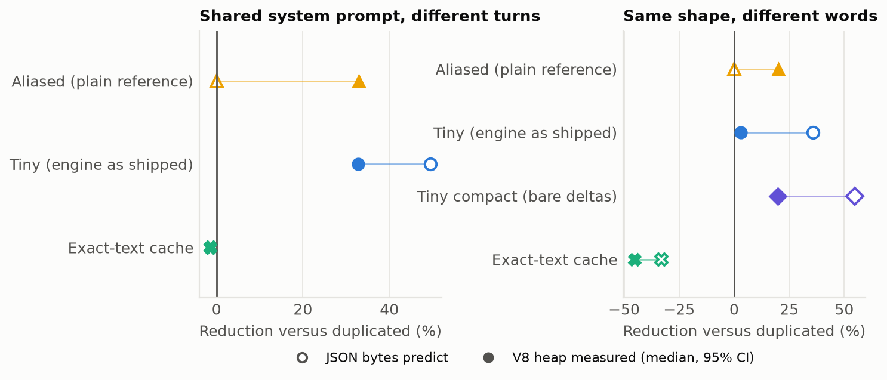

# Manuscript syntax

This project follows the template's [manuscript semantics](https://github.com/docxology/template/blob/main/docs/guides/manuscript-semantics.md). This page holds only what is specific to this manuscript.

## Values

Every study value is a token: `{{AGG_PUBLISHED}}`. Tokens are uppercase with underscores, defined in [`src/manuscript/tokens.mjs`](../../src/manuscript/tokens.mjs), each with a source path and a format. `output/data/manuscript_catalog.json` lists every token's value and source.

| Kind | Example | Comes from |
|---|---|---|
| Result | `{{HEAP_AI_TINY}}` | A path in the analysis summary |
| Design | `{{HEAP_TRIALS}}` | `benchmarks/plan.json` |
| Whole table | `{{TABLE_HEAP}}` | `src/manuscript/tables.mjs` |
| Figure caption | `{{FIG_HEAP_VS_JSON_CAPTION}}` | The figure registry |
| Metadata | `{{PACKAGE_VERSION}}` | `package.json` |

Use tokens in `config.yaml` too. Backticks around a token are fine: it is resolved inside code spans as well.

## What the gate allows

`src/manuscript/contract.mjs` scans authored sections and fails on Arabic numerals and spelled-out study counts ("five trials"). It ignores tokens, code, citations, labels and links. Inside mathematics it allows the constants 0, 1 and 2, as in $1 - T/B$. Named things with digits (`H100`, `UTF-8`, `V8`, `GPT-2`) are on a short allowlist with a reason for each. If the gate flags something, the fix is nearly always a token.

## Cross-references

Use `[@fig:label]`, `[@tbl:label]`, `[@eq:label]` and `[@sec:label]`, which render in lower case, as "fig. 1". Write sentences so a reference does not start them, because the template's pre-render check rejects the capitalized `[@Fig:label]` form as an undefined citation. Definitions and propositions use `[@def:label]` and `[@prop:label]`, which the template's formalism filter numbers.

## Figures

```markdown
{#fig:heap_vs_json width=92%}
```

| Label | File | Generator |
|---|---|---|
| `fig:vendor_architecture` | `vendor_architecture.jpg` | `figures/vendor.py` |
| `fig:workload_reductions` | `workload_reductions.png` | `figures/representation.py` |
| `fig:aggregate_sensitivity` | `aggregate_sensitivity.png` | `figures/representation.py` |
| `fig:session_scaling` | `session_scaling.png` | `figures/representation.py` |
| `fig:rhyme_crossover` | `rhyme_crossover.png` | `figures/representation.py` |
| `fig:gpu_proxy_sensitivity` | `gpu_proxy_sensitivity.png` | `figures/representation.py` |
| `fig:heap_vs_json` | `heap_vs_json.png` | `figures/measured.py` |
| `fig:heap_scaling` | `heap_scaling.png` | `figures/measured.py` |
| `fig:materialization_latency` | `materialization_latency.png` | `figures/measured.py` |
| `fig:llm_prefill` | `llm_prefill.png` | `figures/llm.py` |
| `fig:kv_residency` | `kv_residency.png` | `figures/llm.py` |

## Tables

A table's body is a token. Its caption is authored, with a label:

```markdown
{{TABLE_HEAP}}

: Representation size and live heap by store. {#tbl:heap}
```
